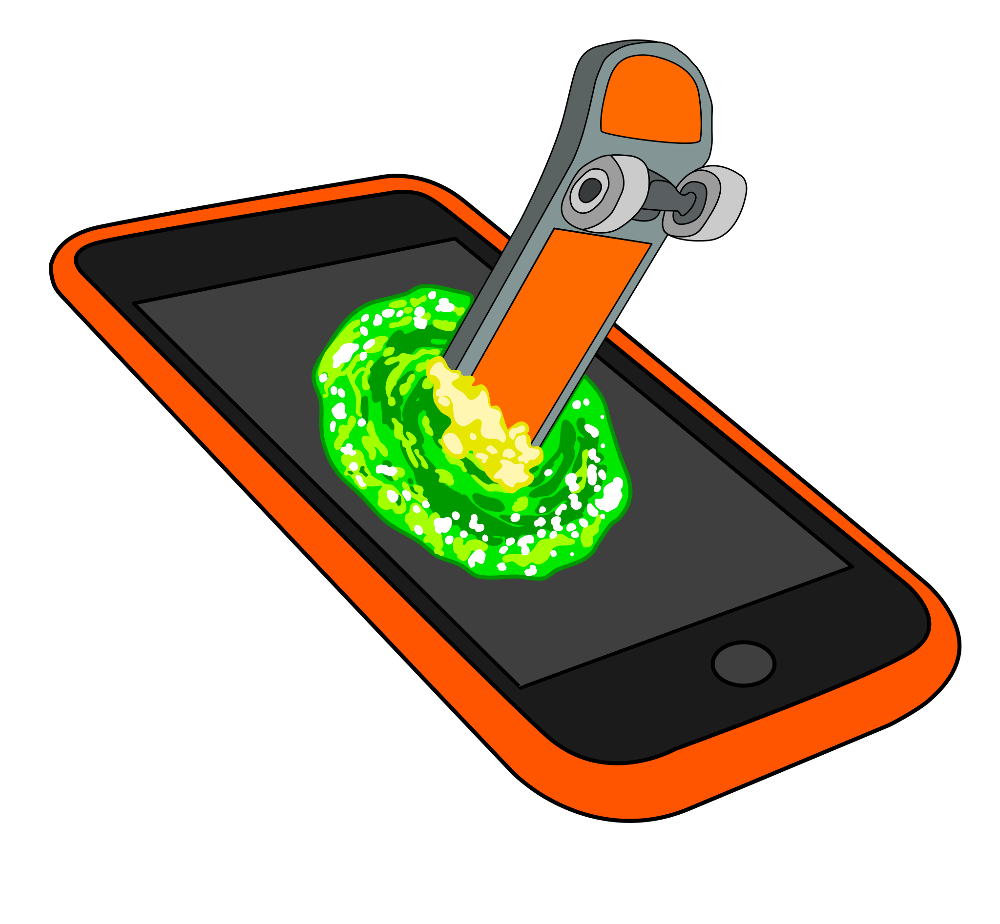

# Skater App

 

  

  <h3 align="center">SkateBuddy</h3>

  

    A convenient companion for skaters to find new parks and shops.
     
    <a href="https://github.com/htl-anichstrasse/skatebuddy/releases">Releases</a>
    ·
    <a href="https://github.com/htl-anichstrasse/skatebuddy/issues">Report Bug</a>
    ·
    <a href="https://github.com/htl-anichstrasse/skatebuddy/issues">Request Feature</a>
  

## Zusammenfassung

Neue Skater haben oft keine Auskunft über die lokalen Parks bzw. wissen gar nicht wie viele
Skateparks es mittlerweile in Tirol gibt. Viele hören deswegen mit dem Skateboarden auf, bevor sie 
überhaupt ihren ersten Trick lernen. Sowohl in der App als auch auf der Website wollen wir einen 
schnellen Überblick über die in der Nähe liegenden Parks bereitstellen, damit neue Skater diese
ausprobieren können und dort vielleicht neue Freunde kennenlernen, welche sie motivieren weiter zu 
machen und nicht aufzugeben.

Es ist Skatern möglich ihre eigene Meinung zu den einzelnen Parks zu äußern und diese dementsprechend 
zu bewerten. Diese Bewertungen helfen neuen Skatern bei der Suche nach beliebten Parks. 
Alternativ ist es möglich die Skateparks nach der Entfernung zu sortieren und somit die Parks in 
der Nähe leichter zu finden.

Falls die Skater einen Park kennen, welcher nicht in der Datenbank vorhanden ist, können 
sie diesen als Vorschlag hinzufügen. Dieser Vorschlag kann von Admins angesehen werden. Die Admins 
können dann Änderungen an diesen Vorschlag vornehmen und anschließend als Park hinzufügen oder den
Vorschlag löschen.

## Bilder

  
  
  
  
  
  
  
  
  
  

## Kontakt

Bei etwaigen Fragen zum Projekt können Sie sich gerne bei uns melden.

### Privat
Schuler Philipp - schulerp03+skatebuddy@gmail.com

### TSN-Emails
Neuner Maximilian - maximilineuner@tsn.at 
Schuler Philipp - pschuler@tsn.at 
Bertoni Alexander - abertoni@tsn.at 
HTL Anichstraße - htlinn@tsn.at

